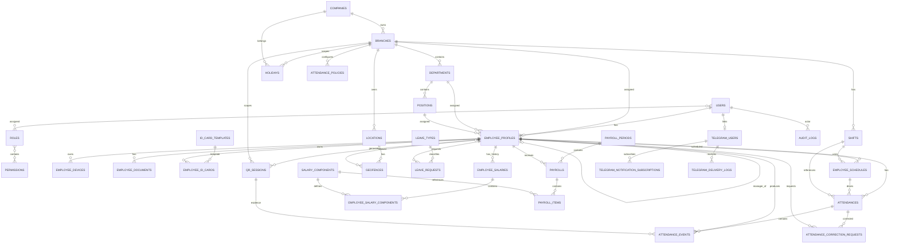
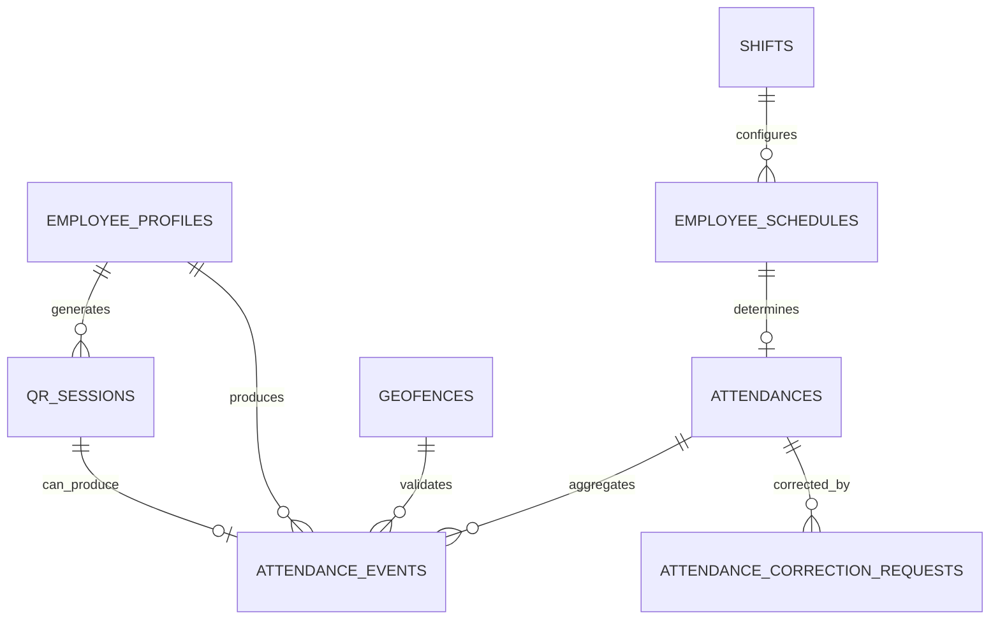
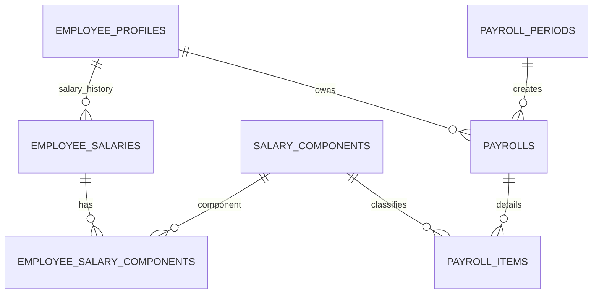
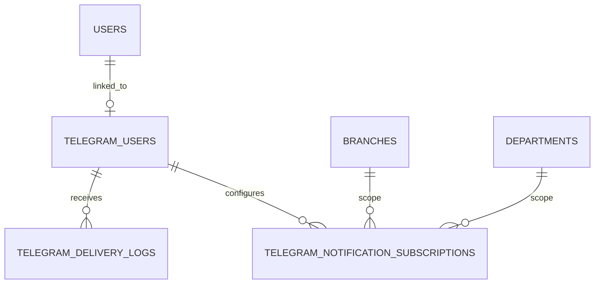

# Absensi — ERD

This file is the canonical high-level ERD for the project.

## 1. Core ERD

---

## 2. Attendance Flow ERD

---

## 3. Salary / Payroll ERD

---

## 4. Telegram ERD

---

## 5. Key Relationship Rules

1. `users` represents authentication identities.
2. `employee_profiles` represents workforce/HR identities.
3. A user may exist without an employee profile.
4. Attendance always references an employee profile.
5. One employee may have multiple salary records over time.
6. One employee may have multiple ID cards historically, but normally only one ACTIVE card.
7. One employee can generate many QR sessions.
8. `attendance_events` is append-only except for exceptional administrative recovery.
9. `attendances` has at most one logical daily attendance record per employee/schedule date.
10. Telegram authorization maps to an existing application user and inherits Laravel permissions.
